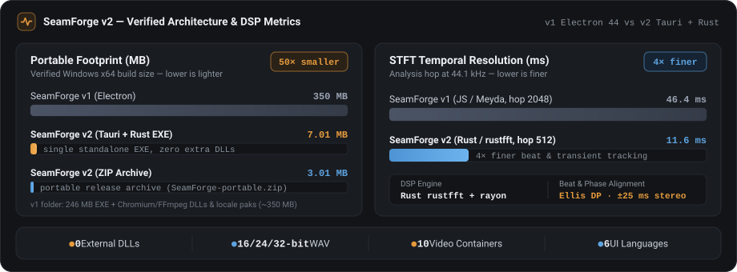

<div align="center">

# SeamForge

**Precision desktop studio for seamless musical audio loops**

[](https://github.com/NIGATAulxgenii/seamforge/actions/workflows/ci.yml)
[](https://github.com/NIGATAulxgenii/seamforge/releases)
[](LICENSE)


**English** · [Русский](docs/README.ru.md) · [简体中文](docs/README.zh-CN.md) · [日本語](docs/README.ja.md) · [Español](docs/README.es.md) · [Deutsch](docs/README.de.md)

Offline multi-threaded Rust DSP · Direct audio extraction from video without FFmpeg · 6.87 MB standalone portable EXE

<br/>


</div>

---

## Overview

**SeamForge v2** automatically discovers musically coherent loop boundaries in audio and video files, aligns stereo phase at the splice point, renders a real-time seam oscilloscope, and exports clean WAV files at the exact original sample rate — 100% offline, with zero external DLLs, zero FFmpeg downloads, and 6 built-in UI languages.

Rewritten from Electron to **Tauri v2 + Rust**, v2 shrinks the portable Windows footprint from **~350 MB to 6.87 MB** (**~51× smaller**, `2.87 MB` zipped) while quadrupling STFT temporal resolution from **46.4 ms to 11.6 ms** (**4× finer**).

<div align="center">



</div>

---

## Comparison

| Capability | **SeamForge v2** | SeamForge v1 (Legacy) | PyMusicLooper | Audacity |
| :--- | :--- | :--- | :--- | :--- |
| **Stack & Footprint** | Tauri v2 + Rust (`6.87 MB` standalone EXE, `2.87 MB` ZIP) | Electron + JS (`~350 MB` portable + optional `5.7 GB` AI cache) | Python CLI / optional TUI (requires Python + NumPy/SciPy/librosa) | C++ / wxWidgets (`~120+ MB` desktop install) |
| **DSP Analysis Engine** | Multi-threaded Rust (`rustfft` + `rayon`), `11.6 ms` hop (`hop=512`), Ellis DP beat tracking | Single-threaded JS (`Meyda`), `46.4 ms` hop (`hop=2048`) | Python music loop & onset analysis (`librosa` / SciPy) | General-purpose audio editing (manual loop hunting) |
| **Auto Musical Loop Finder** | Up to 8 ranked candidates (harmony, phrase, beat, phase scores) | Basic loop search | Strong automated musical loop discovery | Manual selection (no beat/chroma recurrence loop ranking) |
| **Visual Seam Oscilloscope** | Live end/start/blended waveform overlay + ±1/±10 ms nudge | None | Terminal / CLI workflow (no oscilloscope seam editor) | Waveform timeline (no live seam phase overlay) |
| **Direct Video-to-Audio** | Native via `symphonia` + Windows Media Foundation (10 containers, no FFmpeg) | No (audio files only) | Audio-focused CLI (relies on external decoder backends) | Requires optional FFmpeg library for most video containers |
| **Playback & Export** | Gapless WASAPI (`cpal`), `16-bit` (TPDF), `24-bit`, `32-bit float` WAV at native sample rate | Web Audio resampled `16-bit` WAV only | Loop preview & multi-format export via Python audio libs | Full multi-track editing & export |
| **UI Languages** | 6 built-in (`EN`, `RU`, `ZH`, `JA`, `ES`, `DE`) | Russian only | English CLI | Multilingual desktop UI |

---

## DSP Pipeline

```mermaid
flowchart LR
  A["Audio / Video File"] --> B["Symphonia + WMF Decode"]
  B --> C["STFT (hop 512, 11.6 ms)"]
  C --> D["12-Bin Chroma + Onset Flux"]
  D --> E["Fractional BPM + Ellis DP Beats"]
  E --> F["Recurrence Matrix + Diagonal Boost"]
  F --> G["Stereo Phase Align (±25 ms)"]
  G --> H["Top 8 Candidates + Seam Inspector"]
  H --> I["16/24/32-bit WAV Export"]
```



---

## Key Features

- **Native Decoding Without Resampling (`symphonia` + Windows Media Foundation)**
  - Decodes audio and extracts audio tracks directly from video containers at their exact native sample rate — zero FFmpeg binary required.
- **Multi-Threaded Rust Musical DSP (`rustfft` + `rayon`)**
  - High-resolution STFT (`hop = 512`, `11.6 ms` at 44.1 kHz) with silence and `NaN` protection.
  - 12-bin logarithmic chroma, spectral flux, centroid, RMS energy, and timbral balance.
  - Fractional BPM estimation + Ellis (2007) dynamic programming beat tracking with zero beat-grid drift on long tracks.
  - Meter detection (`3/4`, `4/4`) and recurrence matrix with diagonal phrase reinforcement.
  - Joint boundary refinement (`±25 ms`) with stereo phase alignment that preserves exact musical phrase duration.
  - Up to 8 ranked loop candidates with individual Harmony, Phrase, Rhythm, and Phase scores.
- **Interactive Waveform Editor & Live Seam Inspector**
  - High-DPI Canvas waveform with mouse-wheel zoom, horizontal panning, time ruler, and beat grid overlay.
  - Real-time Seam Inspector oscilloscope overlaying loop end, loop start, and blended output.
  - Precision boundary nudging (`±1 ms`, `±10 ms`), zero-crossing snap, selectable crossfade curves (**Constant-Gain** or **Equal-Power**), and pre-analysis source trimming.
- **Native Gapless WASAPI Playback (`cpal`)**
  - Dedicated real-time audio thread with seamless looping and 4 ms anti-click smoothing.
  - Instant seam audition (`S` jumps 2.5 s before the splice) plus smooth monitoring volume and Mute (`M`).
- **Studio WAV Export (`hound`)**
  - **16-bit PCM** (with deterministic TPDF dithering), **24-bit PCM**, and **32-bit IEEE float** at the exact original sample rate.
- **6 Built-in UI Languages**
  - Instant switching between English, Русский, 简体中文, 日本語, Español, and Deutsch.

---

## Supported Formats

| Category | Formats | Notes |
| :--- | :--- | :--- |
| **Audio Input** | `WAV`, `FLAC`, `MP3`, `OGG`, `M4A`, `AAC`, `AIFF` (`AIF`), `Opus`, `WMA` | Decoded natively at original sample rate via `symphonia` + WMF |
| **Video Input** | `MP4`, `MOV`, `MKV`, `WebM`, `AVI`, `WMV`, `M4V`, `3GP`, `MPEG` (`MPG`) | Automatic direct audio track extraction — zero FFmpeg needed |
| **WAV Export** | `16-bit PCM` (TPDF dither), `24-bit PCM`, `32-bit IEEE float` | Exact original sample rate via `hound` |

---

## Download (Portable)

Ready-to-run Windows 10/11 (x64) portable build — no installer, no extra DLLs, no external runtime:

1. Open **[GitHub Releases](https://github.com/NIGATAulxgenii/seamforge/releases)**.
2. Download `SeamForge-portable.zip` (`2.87 MB`) and extract it anywhere.
3. Run `SeamForge.exe` (`6.87 MB` standalone executable).

---

## Keyboard Shortcuts

| Shortcut | Action |
| :--- | :--- |
| `Space` | Play / Pause |
| `S` | Audition seam (jump 2.5 s before loop end) |
| `M` | Mute / Unmute monitoring audio |
| `1–8` | Switch between ranked loop candidates |
| `Ctrl+O` | Open audio or video file |
| `Ctrl+S` | Export seamless WAV |
| `Mouse Wheel` | Zoom waveform in / out |
| `Shift + Wheel` | Scroll waveform horizontally while zoomed |

---

## Project Structure

```text
src-tauri/src/
├── audio_io.rs   # Symphonia + Windows Media Foundation decoding, trim, peaks, WAV export
├── dsp.rs        # STFT, chroma, Ellis DP beat tracking, recurrence matrix, phase align, crossfade
├── playback.rs   # Dedicated WASAPI thread (cpal), gapless loop, smooth gain, anti-click ramp
├── error.rs      # Typed application errors
├── lib.rs        # Tauri v2 IPC commands, analysis cancellation, graceful shutdown
└── main.rs       # Windows desktop entry point

src/
├── api/          # Typed Tauri IPC bridge and native file dialogs
├── components/   # WaveformCanvas, SeamInspector, CandidateSidebar, TransportBar, TrimModal, TitleBar
└── lib/          # 6-language i18n, time/sample-rate formatting utilities + unit tests
```

---

## Build from Source

Prerequisites: **Windows 10/11**, **Node.js 20+**, **Rust 1.90+ (MSVC)**, and **WebView2** (preinstalled on Windows 10/11).

```powershell
# Install frontend dependencies
npm install

# Run in development mode
npm run tauri:dev

# Run full verification: TypeScript, Vitest, Cargo tests, and frontend build
npm run check

# Build standalone portable EXE and ZIP archive (release/SeamForge-portable.zip)
npm run dist:portable
```

---

## License

Licensed under the **[MIT License](LICENSE)**.  
Third-party open-source licenses and attributions (including the MPL-2.0 notice for `symphonia`) are listed in [THIRD_PARTY_LICENSES.md](THIRD_PARTY_LICENSES.md).
