<div align="center">

# SeamForge

**Präzisions-Desktop-Studio für nahtlose musikalische Audio-Loops**

[](https://github.com/NIGATAulxgenii/seamforge/actions/workflows/ci.yml)
[](https://github.com/NIGATAulxgenii/seamforge/releases)
[](../LICENSE)


[English](../README.md) · [Русский](README.ru.md) · [简体中文](README.zh-CN.md) · [日本語](README.ja.md) · [Español](README.es.md) · **Deutsch**

Offline-Multithreading-DSP in Rust · Direkte Audioextraktion aus Videos ohne FFmpeg · 6.87 MB portable Einzel-EXE

<br/>


</div>

---

## Überblick

**SeamForge v2** findet automatisch musikalisch stimmige Loop-Grenzen in Audio- und Videodateien, richtet die Stereophase am Übergang präzise aus, visualisiert die Schnittstelle live im Oszilloskop und exportiert saubere WAV-Dateien in exakter Original-Abtastrate — 100 % offline, ohne externe DLLs, ohne FFmpeg-Download und mit 6 integrierten UI-Sprachen.

Durch die Neuentwicklung von Electron auf **Tauri v2 + Rust** sinkt der portable Windows-Footprint von **~350 MB auf 6.87 MB** (**~51× kleiner**, `2.87 MB` als ZIP), während die zeitliche STFT-Auflösung von **46.4 ms auf 11.6 ms** vervierfacht wird (**4× feiner**).

<div align="center">


</div>

---

## Vergleich

| Funktion | **SeamForge v2** | SeamForge v1 (Altversion) | PyMusicLooper | Audacity |
| :--- | :--- | :--- | :--- | :--- |
| **Stack & Größe** | Tauri v2 + Rust (`6.87 MB` Einzel-EXE, `2.87 MB` ZIP) | Electron + JS (`~350 MB` Ordner + opt. `5.7 GB` KI-Cache) | Python-CLI / opt. TUI (erfordert Python + NumPy/SciPy/librosa) | C++ / wxWidgets (`~120+ MB` Desktop-Installation) |
| **DSP-Analyse-Engine** | Multithreaded Rust (`rustfft` + `rayon`), `11.6 ms` Hop (`hop=512`), Ellis-DP-Beat-Tracking | Singlethreaded JS (`Meyda`), `46.4 ms` Hop (`hop=2048`) | Python-Musikanalyse für Loops & Onsets (`librosa` / SciPy) | Allgemeiner Audioeditor (manuelle Loop-Suche) |
| **Auto-Loop-Erkennung** | Bis zu 8 bewertete Kandidaten (Harmonie, Phrase, Rhythmus, Phase) | Einfache Loop-Suche | Starke automatische musikalische Loop-Erkennung | Manuelle Auswahl (kein Beat-/Chroma-Rekurrenz-Ranking) |
| **Naht-Oszilloskop** | Live-Überlagerung von Ende, Anfang & Überblendung + ±1/±10 ms Feintuning | Nein | Terminal-/CLI-Workflow (kein visuelles Oszilloskop) | Wellenform-Timeline (kein Live-Phasen-Overlay) |
| **Direkter Video-Import** | Nativ via `symphonia` + Windows Media Foundation (10 Container, ohne FFmpeg) | Nein (nur Audiodateien) | Audio-fokussierte CLI (nutzt externe Decoder-Backends) | Erfordert optionale FFmpeg-Bibliothek für die meisten Videos |
| **Wiedergabe & Export** | Gapless WASAPI (`cpal`), `16-bit` (TPDF), `24-bit`, `32-bit float` WAV in Originalrate | Nur über Web Audio resampeltes `16-bit` WAV | Vorschau & Export über Python-Audiobibliotheken | Vollständige Mehrspurbearbeitung & Export |
| **UI-Sprachen** | 6 integriert (`EN`, `RU`, `ZH`, `JA`, `ES`, `DE`) | Nur Russisch | Englische CLI | Mehrsprachige Desktop-UI |

---

## DSP-Pipeline

```mermaid
flowchart LR
  A["Audio / Video-Datei"] --> B["Symphonia + WMF Decode"]
  B --> C["STFT (hop 512, 11.6 ms)"]
  C --> D["12-Band Chroma + Onset Flux"]
  D --> E["Fraktionales BPM + Ellis DP"]
  E --> F["Rekurrenzmatrix + Diagonal-Boost"]
  F --> G["Stereophasen-Abgleich (±25 ms)"]
  G --> H["Top 8 Kandidaten + Inspektor"]
  H --> I["16/24/32-bit WAV-Export"]
```



---

## Hauptfunktionen

- **Natives Dekodieren ohne Resampling (`symphonia` + Windows Media Foundation)**
  - Dekodiert Audio und extrahiert Tonspuren direkt aus Videocontainern in exakter Original-Abtastrate — ganz ohne FFmpeg.
- **Multithreaded Rust-Musik-DSP (`rustfft` + `rayon`)**
  - Hochauflösende STFT (`hop = 512`, `11.6 ms` bei 44.1 kHz) mit Stille- und `NaN`-Schutz.
  - 12-Band-Log-Chroma, Spectral Flux, Centroid, RMS-Energie und Klangfarben-Balance.
  - Fraktionale BPM-Schätzung + Ellis (2007) Dynamic-Programming-Beat-Tracking ohne Drift bei langen Titeln.
  - Taktart-Erkennung (`3/4`, `4/4`) und Rekurrenzmatrix mit diagonaler Phrasenverstärkung.
  - Gemeinsame Grenzfeinjustierung (`±25 ms`) mit Stereophasen-Abgleich bei exakt erhaltener Phrasenlänge.
  - Bis zu 8 gereihte Kandidaten mit Einzelwerten für Harmonie, Phrase, Rhythmus und Phase.
- **Interaktiver Wellenform-Editor & Live-Naht-Inspektor**
  - High-DPI-Canvas-Wellenform mit Mausrad-Zoom, horizontalem Panning, Zeitleiste und Beat-Raster.
  - Live-Oszilloskop zur Überlagerung von Loop-Ende, Loop-Anfang und überblendetem Übergang.
  - Präzises Verschieben (`±1 ms`, `±10 ms`), Nulldurchgangs-Einrastung, wählbare Crossfade-Kurve (**Constant-Gain** oder **Equal-Power**) sowie Vorab-Zuschnitt.
- **Nativer Gapless-WASAPI-Player (`cpal`)**
  - Dedizierter Echtzeit-Audiothread mit lückenloser Schleife und 4 ms Anti-Klick-Glättung.
  - Sofortiges Vorhören des Übergangs (`S` springt 2.5 s vor das Loop-Ende), sanfte Monitoring-Lautstärke und Stummschaltung (`M`).
- **Studio-WAV-Export (`hound`)**
  - **16-bit PCM** (mit deterministischem TPDF-Dithering), **24-bit PCM** und **32-bit IEEE float** in exakter Original-Abtastrate.
- **6 integrierte UI-Sprachen**
  - Sofortiges Umschalten zwischen English, Русский, 简体中文, 日本語, Español und Deutsch.

---

## Unterstützte Formate

| Kategorie | Formate | Hinweis |
| :--- | :--- | :--- |
| **Audio-Eingabe** | `WAV`, `FLAC`, `MP3`, `OGG`, `M4A`, `AAC`, `AIFF` (`AIF`), `Opus`, `WMA` | Nativ in Original-Abtastrate via `symphonia` + WMF |
| **Video-Eingabe** | `MP4`, `MOV`, `MKV`, `WebM`, `AVI`, `WMV`, `M4V`, `3GP`, `MPEG` (`MPG`) | Direkte Audioextraktion ohne FFmpeg |
| **WAV-Export** | `16-bit PCM` (TPDF-Dither), `24-bit PCM`, `32-bit IEEE float` | Exakte Original-Abtastrate via `hound` |

---

## Download (Portable)

Sofort einsatzbereiter Windows 10/11 (x64) Portable-Build — kein Installer, keine zusätzlichen DLLs, keine externe Runtime:

1. Öffne **[GitHub Releases](https://github.com/NIGATAulxgenii/seamforge/releases)**.
2. Lade `SeamForge-portable.zip` (`2.87 MB`) herunter und entpacke das Archiv.
3. Starte `SeamForge.exe` (`6.87 MB` eigenständige Programmdatei).

---

## Tastenkürzel

| Tastenkürzel | Aktion |
| :--- | :--- |
| `Space` | Wiedergabe / Pause |
| `S` | Übergang vorhören (Sprung 2.5 s vor Loop-Ende) |
| `M` | Monitoring stummschalten / aktivieren |
| `1–8` | Zwischen gefundenen Loop-Kandidaten wechseln |
| `Ctrl+O` | Audio- oder Videodatei öffnen |
| `Ctrl+S` | Nahtlose WAV-Datei exportieren |
| `Mausrad` | Wellenform vergrößern / verkleinern |
| `Shift + Mausrad` | Horizontal scrollen bei Zoom |

---

## Projektstruktur

```text
src-tauri/src/
├── audio_io.rs   # Symphonia + Windows Media Foundation Decode, Trim, Peaks, WAV-Export
├── dsp.rs        # STFT, Chroma, Ellis-DP-Beat-Tracking, Rekurrenzmatrix, Phasenabgleich, Crossfade
├── playback.rs   # Dedizierter WASAPI-Thread (cpal), Gapless-Loop, sanfte Lautstärke, Anti-Klick
├── error.rs      # Typisierte Anwendungsfehler
├── lib.rs        # Tauri-v2-IPC-Befehle, Analyse-Abbruch, sauberes Beenden
└── main.rs       # Windows-Desktop-Einstiegspunkt

src/
├── api/          # Typisierte Tauri-IPC-Brücke und native Dateidialoge
├── components/   # WaveformCanvas, SeamInspector, CandidateSidebar, TransportBar, TrimModal, TitleBar
└── lib/          # 6-Sprachen-i18n, Formatierungs-Hilfsfunktionen & Unit-Tests
```

---

## Aus dem Quellcode bauen

Voraussetzungen: **Windows 10/11**, **Node.js 20+**, **Rust 1.90+ (MSVC)** und **WebView2** (in Windows 10/11 vorinstalliert).

```powershell
# Frontend-Abhängigkeiten installieren
npm install

# Im Entwicklungsmodus starten
npm run tauri:dev

# Vollständige Prüfung: TypeScript, Vitest, Cargo-Tests und Frontend-Build
npm run check

# Eigenständige portable EXE und ZIP-Archiv erstellen (release/SeamForge-portable.zip)
npm run dist:portable
```

---

## Lizenz

Lizenziert unter der **[MIT-Lizenz](../LICENSE)**.  
Lizenzen und Hinweise zu verwendeten Open-Source-Bibliotheken (einschließlich des MPL-2.0-Hinweises für `symphonia`) sind in [THIRD_PARTY_LICENSES.md](../THIRD_PARTY_LICENSES.md) aufgeführt.
