<div align="center">


# SeamForge

**Настольная студия для создания бесшовных музыкальных аудиопетель**

[](https://github.com/NIGATAulxgenii/seamforge/actions/workflows/ci.yml)
[](https://github.com/NIGATAulxgenii/seamforge/releases)
[](../LICENSE)


[English](../README.md) · **Русский** · [简体中文](README.zh-CN.md) · [日本語](README.ja.md) · [Español](README.es.md) · [Deutsch](README.de.md)

Офлайн многопоточный DSP на Rust · Извлечение звука из видео без FFmpeg · Автономный portable EXE 7.04 МБ

<br/>


</div>

---

## О проекте

**SeamForge v2** автоматически находит музыкально согласованные границы петли в аудио- и видеофайлах, выравнивает стереофазу в точке склейки, показывает стык на осциллографе в реальном времени и экспортирует чистый WAV в исходной частоте дискретизации — полностью офлайн, без сторонних DLL, без загрузки FFmpeg и с 6 встроенными языками интерфейса.

После переписывания с Electron на **Tauri v2 + Rust** размер portable-сборки для Windows сократился с **~350 МБ до 7.04 МБ** (**в ~50 раз меньше**, ZIP-архив — `3.04 МБ`), а временное разрешение STFT-анализа выросло с **46.4 мс до 11.6 мс** (**в 4 раза точнее**).

<div align="center">


</div>

---

## Сравнение

| Возможность | **SeamForge v2** | SeamForge v1 (предыдущая) | PyMusicLooper | Audacity |
| :--- | :--- | :--- | :--- | :--- |
| **Стек и размер** | Tauri v2 + Rust (`7.04 МБ` один EXE, `3.04 МБ` ZIP) | Electron + JS (`~350 МБ` папка + опц. `5.7 ГБ` ИИ-кэш) | Python CLI / опц. TUI (нужен Python + NumPy/SciPy/librosa) | C++ / wxWidgets (`~120+ МБ` установка) |
| **DSP-движок** | Многопоточный Rust (`rustfft` + `rayon`), шаг `11.6 мс` (`hop=512`), Ellis DP beat tracking | Однопоточный JS (`Meyda`), шаг `46.4 мс` (`hop=2048`) | Анализ музыкальных петель на Python (`librosa` / SciPy) | Универсальный аудиоредактор (ручной поиск стыка) |
| **Автопоиск музыкальных петель** | До 8 ранжированных кандидатов (гармония, фраза, ритм, фаза) | Базовый поиск петель | Сильный автоматический поиск музыкальных петель | Ручной выбор (без ранжирования по матрице рекуррентности) |
| **Осциллограф стыка** | Наложение конца, начала и итоговой склейки + сдвиг ±1/±10 мс | Нет | Терминальный CLI-режим (нет визуального редактора стыка) | Временная шкала волны (нет наложения фаз стыка) |
| **Звук напрямую из видео** | Нативно через `symphonia` + Windows Media Foundation (10 контейнеров, без FFmpeg) | Нет (только аудиофайлы) | Ориентирован на аудио (зависит от внешних декодеров) | Для большинства видеоконтейнеров нужен внешний FFmpeg |
| **Воспроизведение и экспорт** | Gapless WASAPI (`cpal`), WAV `16-bit` (TPDF), `24-bit`, `32-bit float` без ресэмплинга | Только `16-bit` WAV с ресэмплингом Web Audio | Предпрослушивание и экспорт через Python-библиотеки | Многодорожечное редактирование и экспорт |
| **Языки интерфейса** | 6 встроенных (`EN`, `RU`, `ZH`, `JA`, `ES`, `DE`) | Только русский | Английский CLI | Многоязычный интерфейс |

---

## Конвейер DSP-анализа

```mermaid
flowchart LR
  A["Аудио / Видеофайл"] --> B["Декодирование Symphonia + WMF"]
  B --> C["STFT (hop 512, 11.6 мс)"]
  C --> D["12-полосная Chroma + Flux"]
  D --> E["Дробный BPM + Ellis DP Доли"]
  E --> F["Матрица рекуррентности"]
  F --> G["Подгонка стереофазы (±25 мс)"]
  G --> H["Топ-8 кандидатов + Инспектор"]
  H --> I["Экспорт WAV 16/24/32-bit"]
```



---

## Ключевые возможности

- **Нативное декодирование без ресэмплинга (`symphonia` + Windows Media Foundation)**
  - Декодирует аудио и извлекает аудиодорожки напрямую из видеоконтейнеров в оригинальной частоте дискретизации — без бинарников FFmpeg.
- **Многопоточный музыкальный DSP на Rust (`rustfft` + `rayon`)**
  - Мелкий STFT (`hop = 512`, `11.6 мс` при 44.1 кГц) с защитой от тишины и `NaN`.
  - 12-полосная логарифмическая chroma, спектральный флюкс, центроид, RMS и тембральный баланс.
  - Дробное определение темпа (BPM) + динамическое программирование Ellis (2007) без дрейфа сетки долей на длинных треках.
  - Определение тактового размера (`3/4`, `4/4`) и матрица рекуррентности с усилением диагоналей повторяющихся фраз.
  - Совместный сдвиг границ (`±25 мс`) с выравниванием стереофазы и сохранением точной длины музыкальной фразы.
  - До 8 ранжированных кандидатов с оценками по гармонии, фразе, ритму и фазе.
- **Интерактивный редактор волны и Инспектор стыка**
  - High-DPI Canvas-волна с масштабированием колесом мыши, панорамированием, линейкой времени и сеткой долей.
  - Осциллограф стыка в реальном времени (наложение конца петли, начала и итоговой склейки).
  - Точная подстройка границ (`±1 мс`, `±10 мс`), привязка к zero crossing, выбор кривой crossfade (**Constant-Gain** или **Equal-Power**) и предварительная обрезка исходника.
- **Нативный gapless WASAPI-плеер (`cpal`)**
  - Выделенный аудиопоток реального времени с бесшовным зацикливанием и 4 мс анти-клик сглаживанием.
  - Мгновенная проверка склейки (`S` — переход за 2.5 с до конца петли), плавная громкость и Mute (`M`).
- **Студийный экспорт WAV (`hound`)**
  - **16-bit PCM** (с детерминированным TPDF-дизерингом), **24-bit PCM** и **32-bit IEEE float** в исходной частоте дискретизации.
- **6 встроенных языков интерфейса**
  - Мгновенное переключение: English, Русский, 简体中文, 日本語, Español и Deutsch.

---

## Поддерживаемые форматы

| Категория | Форматы | Примечание |
| :--- | :--- | :--- |
| **Аудио (вход)** | `WAV`, `FLAC`, `MP3`, `OGG`, `M4A`, `AAC`, `AIFF` (`AIF`), `Opus`, `WMA` | Нативное декодирование в исходной частоте через `symphonia` + WMF |
| **Видео (вход)** | `MP4`, `MOV`, `MKV`, `WebM`, `AVI`, `WMV`, `M4V`, `3GP`, `MPEG` (`MPG`) | Автоматическое извлечение аудиодорожки — FFmpeg не требуется |
| **Экспорт WAV** | `16-bit PCM` (TPDF-дизеринг), `24-bit PCM`, `32-bit IEEE float` | Точная исходная частота дискретизации (`hound`) |

---

## Скачать (Portable)

Готовая переносимая сборка для Windows 10/11 (x64) без установщика, сторонних DLL и внешних рантаймов:

1. Перейдите в раздел **[GitHub Releases](https://github.com/NIGATAulxgenii/seamforge/releases)**.
2. Скачайте `SeamForge-portable.zip` (`3.04 МБ`) и распакуйте в любую папку.
3. Запустите `SeamForge.exe` (`7.04 МБ` автономный исполняемый файл).

---

## Горячие клавиши

| Клавиша | Действие |
| :--- | :--- |
| `Space` | Воспроизведение / пауза |
| `S` | Прослушать стык (переход за 2.5 с до склейки) |
| `M` | Выключить / включить звук мониторинга |
| `1–8` | Переключение между найденными кандидатами |
| `Ctrl+O` | Открыть аудио- или видеофайл |
| `Ctrl+S` | Экспортировать бесшовный WAV |
| `Колесо мыши` | Масштабирование волновой формы |
| `Shift + колесо` | Горизонтальная прокрутка при увеличении |

---

## Структура проекта

```text
src-tauri/src/
├── audio_io.rs   # Декодирование Symphonia + Windows Media Foundation, обрезка, пики, экспорт WAV
├── dsp.rs        # STFT, chroma, Ellis DP beat tracking, матрица рекуррентности, фаза, crossfade
├── playback.rs   # Выделенный WASAPI-поток (cpal), gapless loop, плавная громкость, анти-клик
├── error.rs      # Типизированные ошибки приложения
├── lib.rs        # Tauri v2 IPC-команды, отмена анализа, корректное завершение процесса
└── main.rs       # Точка входа настольного приложения Windows

src/
├── api/          # Типизированный мост к Tauri IPC и системным диалогам
├── components/   # WaveformCanvas, SeamInspector, CandidateSidebar, TransportBar, TrimModal, TitleBar
└── lib/          # Локализация на 6 языков (i18n), форматирование времени и частоты + тесты
```

---

## Сборка из исходников

Требования: **Windows 10/11**, **Node.js 20+**, **Rust 1.90+ (MSVC)** и **WebView2** (встроен в Windows 10/11).

```powershell
# Установка зависимостей фронтенда
npm install

# Запуск в режиме разработки
npm run tauri:dev

# Полная проверка: TypeScript, Vitest, Cargo tests и сборка фронтенда
npm run check

# Сборка автономного EXE и ZIP-архива (release/SeamForge-portable.zip)
npm run dist:portable
```

---

## Лицензия

Проект распространяется под лицензией **[MIT](../LICENSE)**.  
Список сторонних open-source библиотек и их лицензий (включая уведомление MPL-2.0 для `symphonia`) находится в [THIRD_PARTY_LICENSES.md](../THIRD_PARTY_LICENSES.md).
