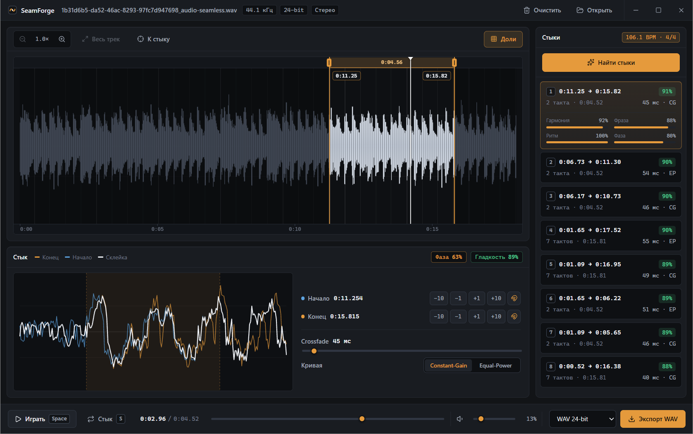

<div align="center">

# SeamForge

**专为无缝音乐循环打造的高精度桌面音频工作室**

[](https://github.com/NIGATAulxgenii/seamforge/actions/workflows/ci.yml)
[](https://github.com/NIGATAulxgenii/seamforge/releases)
[](../LICENSE)


[English](../README.md) · [Русский](README.ru.md) · **简体中文** · [日本語](README.ja.md) · [Español](README.es.md) · [Deutsch](README.de.md)

离线多线程 Rust DSP · 无需 FFmpeg 直接提取视频音轨 · 6.87 MB 单文件便携版 EXE

<br/>



</div>

---

## 项目简介

**SeamForge v2** 能够自动在音频与视频文件中定位音乐结构契合的循环切点，在接缝处自动对齐立体声相位，提供实时接缝示波器叠加视图，并以原始采样率无损导出干净的 WAV 文件——完全离线运行，零外部 DLL 依赖，无需下载 FFmpeg，内置 6 种界面语言。

从 Electron 全面重构为 **Tauri v2 + Rust** 后，v2 将 Windows 便携版体积从 **~350 MB 缩减至 6.87 MB**（**缩小约 51 倍**，ZIP 压缩包仅 `2.87 MB`），同时将 STFT 时间分辨率从 **46.4 ms 提升至 11.6 ms**（**精细度提升 4 倍**）。

<div align="center">


</div>

---

## 工具对比

| 特性 | **SeamForge v2** | SeamForge v1（旧版） | PyMusicLooper | Audacity |
| :--- | :--- | :--- | :--- | :--- |
| **技术栈与体积** | Tauri v2 + Rust（`6.87 MB` 单文件 EXE，`2.87 MB` ZIP） | Electron + JS（`~350 MB` 目录 + 可选 `5.7 GB` AI 缓存） | Python CLI / 可选 TUI（需 Python + NumPy/SciPy/librosa） | C++ / wxWidgets（`~120+ MB` 桌面安装包） |
| **DSP 分析引擎** | 多线程 Rust（`rustfft` + `rayon`），`11.6 ms` 步长（`hop=512`），Ellis DP 节拍跟踪 | 单线程 JS（`Meyda`），`46.4 ms` 步长（`hop=2048`） | Python 音乐循环与起音分析（`librosa` / SciPy） | 通用音频编辑（需手动寻找循环点） |
| **自动音乐循环查找** | 最多 8 个综合评分候选（和声、乐句、节奏、相位） | 基础循环查找 | 强大的自动音乐循环查找能力 | 手动选区（无节拍/色度自相似矩阵排名） |
| **可视化接缝示波器** | 实时显示尾部/头部/淡入淡出叠加波形 + ±1/±10 ms 微调 | 无 | 终端命令行工作流（无示波器接缝编辑器） | 波形时间轴（无实时接缝相位叠加） |
| **视频直出音频** | 原生 `symphonia` + Windows Media Foundation（支持 10 种容器，零 FFmpeg） | 不支持（仅音频文件） | 偏重音频的 CLI（依赖外部解码后端） | 多数视频容器需额外安装 FFmpeg 库 |
| **播放与导出** | 无缝 WASAPI（`cpal`），原采样率 `16-bit`（TPDF）、`24-bit`、`32-bit float` WAV | 仅限 Web Audio 重采样后的 `16-bit` WAV | 通过 Python 音频库进行预览与导出 | 完整多轨编辑与多格式导出 |
| **界面语言** | 内置 6 种（`EN`、`RU`、`ZH`、`JA`、`ES`、`DE`） | 仅俄语 | 英文 CLI | 多语言桌面界面 |

---

## DSP 分析管线


---

## 核心功能

- **无重采样原生解码（`symphonia` + Windows Media Foundation）**
  - 按原始采样率直接解码音频并提取视频容器中的音轨，无需任何 FFmpeg 二进制文件。
- **多线程 Rust 音乐 DSP 引擎（`rustfft` + `rayon`）**
  - 高精度 STFT（`hop = 512`，44.1 kHz 下为 `11.6 ms`），内置静音与 `NaN` 保护。
  - 12 维对数色度（Chroma）、频谱通量、频谱质心、RMS 能量与音色平衡特征提取。
  - 小数级 BPM 检测 + Ellis（2007）动态规划节拍跟踪，长音轨无节拍漂移。
  - 拍号检测（`3/4`、`4/4`）与对角乐句增强的自相似矩阵。
  - 联合边界微调（`±25 ms`）与立体声相位对齐，严格保持乐句时长不变。
  - 最多生成 8 个排序候选点，提供和声、乐句、节奏与相位分项评分。
- **交互式波形编辑器与实时接缝检查器**
  - High-DPI Canvas 波形视图，支持滚轮缩放、水平拖拽平移、时间标尺与节拍网格。
  - 实时接缝示波器，同屏叠加循环尾部、循环头部与最终交叉淡化波形。
  - 精准微调边界（`±1 ms`、`±10 ms`）、过零点吸附、可选交叉淡化曲线（**Constant-Gain** 或 **Equal-Power**），支持分析前预裁剪。
- **原生无缝 WASAPI 播放器（`cpal`）**
  - 独立实时音频线程，实现无缝循环播放与 4 ms 抗爆音平滑过渡。
  - 一键试听接缝（按 `S` 跳转至循环结束前 2.5 秒）、平滑监听音量调节与静音（`M`）。
- **工作室级 WAV 导出（`hound`）**
  - 支持 **16-bit PCM**（确定性 TPDF 抖动）、**24-bit PCM** 与 **32-bit IEEE float**，完全保留原始采样率。
- **内置 6 种界面语言**
  - 一键切换 English、Русский、简体中文、日本語、Español 与 Deutsch。

---

## 支持格式

| 类别 | 支持格式 | 说明 |
| :--- | :--- | :--- |
| **音频输入** | `WAV`, `FLAC`, `MP3`, `OGG`, `M4A`, `AAC`, `AIFF` (`AIF`), `Opus`, `WMA` | 通过 `symphonia` + WMF 按原采样率原生解码 |
| **视频输入** | `MP4`, `MOV`, `MKV`, `WebM`, `AVI`, `WMV`, `M4V`, `3GP`, `MPEG` (`MPG`) | 自动直接提取音轨，无需 FFmpeg |
| **WAV 导出** | `16-bit PCM`（TPDF 抖动）, `24-bit PCM`, `32-bit IEEE float` | 通过 `hound` 按原始采样率精准导出 |

---

## 下载（便携版）

开箱即用的 Windows 10/11（x64）绿色便携版——免安装、无额外 DLL、无需外部运行时：

1. 前往 **[GitHub Releases](https://github.com/NIGATAulxgenii/seamforge/releases)** 页面。
2. 下载 `SeamForge-portable.zip`（`2.87 MB`）并解压至任意目录。
3. 直接运行 `SeamForge.exe`（`6.87 MB` 单文件可执行程序）。

---

## 快捷键

| 快捷键 | 功能 |
| :--- | :--- |
| `Space` | 播放 / 暂停 |
| `S` | 试听接缝（跳转至循环结束前 2.5 秒） |
| `M` | 静音 / 取消监听静音 |
| `1–8` | 切换不同的循环候选点 |
| `Ctrl+O` | 打开音频或视频文件 |
| `Ctrl+S` | 导出无缝 WAV 文件 |
| `鼠标滚轮` | 缩放波形视图 |
| `Shift + 滚轮` | 放大状态下水平滚动波形 |

---

## 项目结构

```text
src-tauri/src/
├── audio_io.rs   # Symphonia + Windows Media Foundation 解码、裁剪、波形峰值、WAV 导出
├── dsp.rs        # STFT、色度、Ellis DP 节拍跟踪、自相似矩阵、相位对齐、交叉淡化
├── playback.rs   # 独立 WASAPI 线程（cpal）、无缝循环、平滑增益、抗爆音过渡
├── error.rs      # 类型化应用错误处理
├── lib.rs        # Tauri v2 IPC 命令、分析取消与优雅退出
└── main.rs       # Windows 桌面端入口

src/
├── api/          # 类型化 Tauri IPC 桥接与系统文件对话框
├── components/   # WaveformCanvas, SeamInspector, CandidateSidebar, TransportBar, TrimModal, TitleBar
└── lib/          # 6 语言 i18n、时间/采样率/文件名格式化工具及单元测试
```

---

## 从源码构建

环境要求：**Windows 10/11**、**Node.js 20+**、**Rust 1.90+（MSVC）** 以及 **WebView2**（Windows 10/11 已内置）。

```powershell
# 安装前端依赖
npm install

# 启动开发模式
npm run tauri:dev

# 运行完整验证：TypeScript、Vitest、Cargo 测试与前端构建
npm run check

# 构建单文件便携 EXE 与 ZIP 压缩包（release/SeamForge-portable.zip）
npm run dist:portable
```

---

## 开源协议

本项目基于 **[MIT License](../LICENSE)** 开源。  
第三方开源库及其许可声明（包含 `symphonia` 的 MPL-2.0 声明）请参阅 [THIRD_PARTY_LICENSES.md](../THIRD_PARTY_LICENSES.md)。
